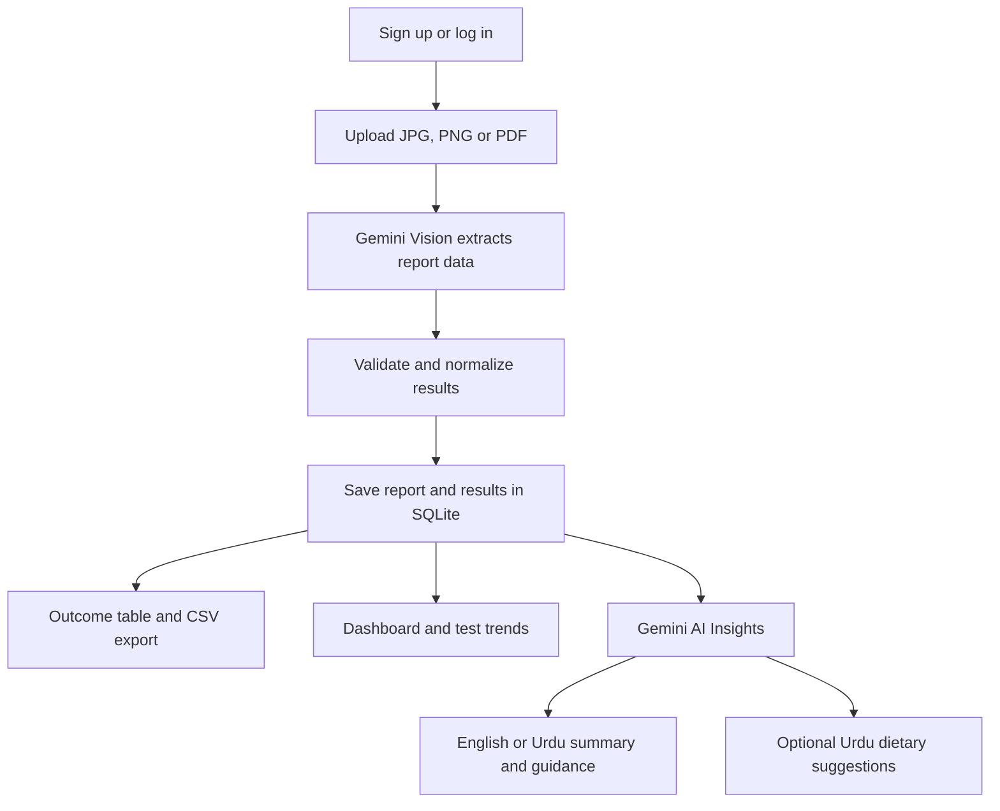

# MedAssistAI 🩺

**An AI-powered medical laboratory report organizer and educational explainer built with Python, Streamlit, SQLite, and Google Gemini.**

MedAssistAI helps users upload laboratory reports, review extracted results, track test history, and read easy-to-understand educational explanations in **English or Urdu**.

> **Important:** MedAssistAI is a student software project for educational use. It is **not** a medical device, a diagnosis service, or a substitute for a qualified healthcare professional.

## Features

- **AI report extraction:** Uses Gemini Vision to read test names, values, units, reference ranges, and report metadata from an uploaded image or PDF.
- **Multiple report categories:** Detects CBC, blood sugar, lipid profile, liver function, kidney function, and thyroid reports from extracted test names; other reports are labeled *Other*.
- **Result classification:** Displays **Normal**, **High**, **Low**, or **Unknown** using available report reference ranges. Missing or unclear data must not be guessed.
- **Personal report history:** User signup/login, saved reports, result tables, CSV downloads, and report deletion.
- **One-page Streamlit experience:** Upload, reports, charts, AI Insights, and account settings are displayed in a continuous scrollable workspace.
- **Interactive dashboard:** Summary statistics, status breakdown, and trends for tests appearing across saved reports.
- **Bilingual AI Insights:** Generates a patient-friendly report summary and general guidance in **English or Urdu**. The current prompt focuses on result statuses rather than repeating numerical values.
- **Urdu dietary guidance:** Optional general food suggestions and a home recipe, explicitly **not a treatment or cure**.
- **Optional Google Sheets sync:** Synchronizes account metadata such as user ID, name, email, creation time, and last login when configured; not passwords.
- **Account settings and export:** Change name or password, and export account report data in CSV or JSON format.

## How it works



**Current limitation:** The active Gemini extractor renders and processes only the **first page of a PDF**. Uploading does **not** currently require a manual confirmation step: extracted rows are saved automatically, so the user must review the resulting report table against the source image. AI extraction and classification can be wrong.

## Tech stack

| Component | Technology |
| --- | --- |
| User interface | Streamlit |
| AI report extraction & explanation | Google Gemini via `google-genai` |
| Data models | Pydantic |
| Database | SQLite |
| Data analysis | Pandas |
| Visualization | Plotly |
| PDF page rendering | PyMuPDF |
| Authentication utilities | bcrypt |
| Optional cloud spreadsheet sync | Google Sheets API, gspread, Google Auth |
| Configuration | python-dotenv / Streamlit secrets |

## Project structure

The repository root README provides an overview; this file documents the implementation in more detail. The application currently lives in the **`MedAssistAI/`** subdirectory of this GitHub repository.

```text
MedAssist-AI/
└── MedAssistAI/
    ├── app.py                  # Streamlit entry point
    ├── requirements.txt
    ├── theme.py
    ├── ai/
    │   └── insights.py        # Bilingual AI explanations & Urdu recipes
    ├── auth/                  # Signup, login & auth helpers
    ├── database/              # SQLite models & optional Google Sheets
    ├── ocr/
    │   ├── gemini_extractor.py
    │   └── validator.py
    ├── views/                 # Home, upload, reports, dashboard, insights, settings
    └── uploads/               # Uploaded report files (keep private)
```

## Run locally

**1. Clone the repository**

```bash
git clone https://github.com/Usmanshakir7/MedAssist-AI.git
cd MedAssist-AI/MedAssistAI
```

**2. Create and activate a virtual environment**

Windows:

```powershell
python -m venv .venv
.venv\Scripts\activate
```

macOS / Linux:

```bash
python3 -m venv .venv
source .venv/bin/activate
```

**3. Install dependencies**

```bash
pip install -r requirements.txt
```

**4. Configure Gemini**

Get an API key from [Google AI Studio](https://aistudio.google.com/apikey). Create a local `.env` file inside `MedAssistAI/`:

```dotenv
GEMINI_API_KEY=your_api_key_here
# Optional: choose a model available to your account
GEMINI_MODEL=your_supported_model_id
```

The extractor loads `.env` through `python-dotenv`. You may also configure `GEMINI_API_KEY` using Streamlit secrets. Check model availability in your Gemini account if a model-not-found error occurs.

**5. Start the app**

```bash
streamlit run app.py
```

Open the local URL displayed by Streamlit, register an account, and upload a clear laboratory report.

## Optional Google Sheets setup

The `database/google_sheets.py` module expects a Streamlit secret called `[gcp_service_account]` and an optional spreadsheet name. If you enable this integration:

1. Set up a Google Cloud service account and enable the necessary Google Sheets / Drive APIs.
2. Share the target spreadsheet with the service account email.
3. Put the service-account fields in a **local** `.streamlit/secrets.toml` file under `[gcp_service_account]`.
4. Set `google_sheet_name = "MedAssistAI Users"` at the top level if you use the default spreadsheet name.

The connector uses the **Users** worksheet when present, otherwise the first worksheet. It stores account metadata rather than passwords. Keep credentials out of source control.

## What the AI output means

The laboratory result table is where exact numbers, units and supplied reference intervals appear. The **AI Insights** section is designed to provide a short explanation of findings by status—**Normal, Low, High, or Cannot assess**—without turning those results into a diagnosis.

A percentage result and its corresponding **absolute count** are different measurements; one can be outside its range while the other is normal. Results with missing values or unsuitable reference information should be treated as uncertain rather than estimated.

AI-generated summaries, recipes, and suggested follow-up are **informational only**. Dietary needs depend on individual circumstances and medical history; a report alone is not enough for personalized medical nutrition advice.

## Privacy and limitations

- **Prototype, not a production clinical system:** do not deploy for real patient care without a security, privacy, and clinical validation review.
- Uploaded reports and medical test results are sensitive personal information. Use sample or appropriately de-identified data during development.
- Images and extracted information are sent to the configured Gemini service for processing. Review the provider's data handling terms before using real patient reports.
- The current application stores files and its SQLite database locally; it is **not presented as production-grade clinical infrastructure**.
- Keep `.env`, `.streamlit/secrets.toml`, service-account JSON, `*.db`, and contents of `uploads/` **out of Git commits**.
- Verify extracted values against the original report. Document scanning, missing ranges, age-specific ranges, and incorrect classifications can affect output.
- The current PDF extractor only reads the first page.
- Statuses are computed from extracted numerical values and reference bounds, not from full clinical context; age/sex-specific intervals and open-ended bounds may need more careful handling.
- The upload flow saves extracted results automatically without a required correction step.
- The README describes the code in this repository; local changes not yet pushed may differ.

## Future improvements

- Multi-page PDF processing and stronger extraction quality checks.
- User confirmation/correction of extracted values **before** saving (not yet implemented).
- More robust handling of age-, sex-, and lab-specific reference ranges.
- Automated tests and security hardening for deployment.
- Better accessibility and Urdu-language presentation.
- Carefully evaluated report-type coverage and clearer uncertainty handling.

## Project status

**Student project / active development.** This repository demonstrates practical work in Python application development, generative AI integration, structured extraction, SQLite-backed data handling, and interactive data visualization.

---

**Developed by [Usman Shakir](https://github.com/Usmanshakir7)**

*MedAssistAI explains laboratory data for learning and awareness. It does not provide medical diagnoses or treatment decisions.*
