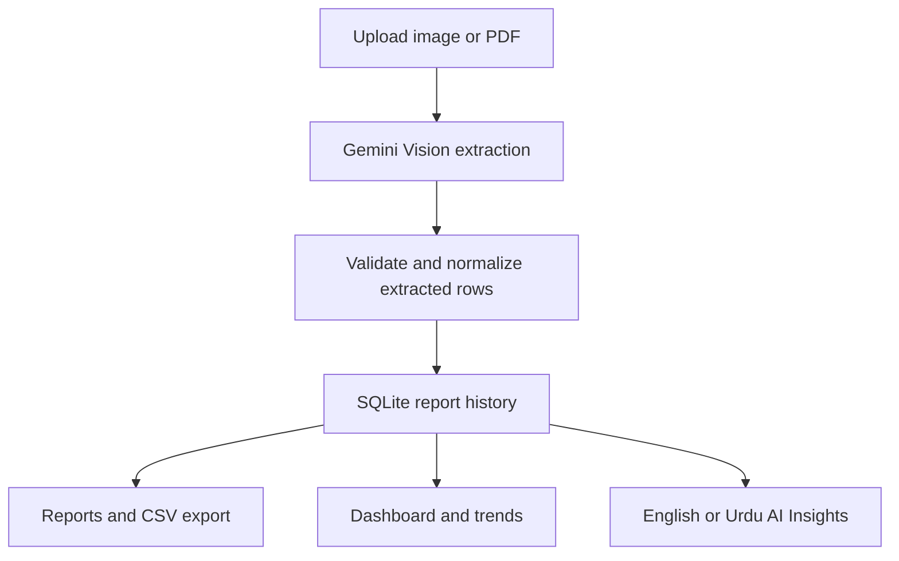

# MedAssistAI 🩺

**AI-powered medical laboratory report organizer and educational explainer**

MedAssistAI is a Python + Streamlit student project that turns uploaded lab-report images and PDFs into structured test results using Google Gemini, saves them to SQLite, and helps users explore their report history with interactive charts and simple AI-generated explanations.

> **Medical disclaimer:** This project is for educational use only. It is not a medical device, diagnostic service, or substitute for professional clinical advice. AI-extracted values must be checked against the source report.

## What it does

- **Multimodal extraction:** Gemini reads JPG/PNG images and the first page of PDF reports, returning test names, values, units, reference ranges, and visible report metadata.
- **Report categorization:** CBC, Blood Sugar, Lipid Profile, Liver Function Test, Kidney Function Test, Thyroid Profile, and Other are inferred from extracted test names; coverage and quality vary by lab and layout.
- **Result status:** Numeric values are compared with extracted reference ranges and labeled Normal, Low, High, or Unknown.
- **Account and report history:** Signup/login, saved reports, CSV export, and report deletion.
- **Dashboard:** Report counts, status breakdowns, and trends for repeated lab tests.
- **AI Insights:** Educational summaries and general guidance in English or Urdu, plus optional Urdu dietary suggestions.
- **Settings:** Update profile/password and export report data as CSV or JSON.
- **Optional Google Sheets:** Syncs limited user-account metadata when configured; does not sync passwords.

## How it works



## Technology

| Layer | Stack |
| --- | --- |
| Frontend | Streamlit, custom CSS |
| AI | Google Gemini (`google-genai`), Pydantic |
| Database & auth | SQLite, bcrypt |
| Data & charts | Pandas, Plotly |
| PDF processing | PyMuPDF (first page) |
| Optional integration | Google Sheets (`gspread`, Google Auth) |

## Quick start

The runnable app is in the **`MedAssistAI/`** directory.

```bash
git clone https://github.com/Usmanshakir7/MedAssist-AI.git
cd MedAssist-AI/MedAssistAI
python -m venv .venv
```

Activate the environment on Windows with `.venv\Scripts\activate` or on macOS/Linux with `source .venv/bin/activate`, then install dependencies:

```bash
python -m pip install -r requirements.txt
```

Get a Gemini API key from [Google AI Studio](https://aistudio.google.com/apikey). Set `GEMINI_API_KEY` in a local `.env` file in the `MedAssistAI/` folder:

```dotenv
GEMINI_API_KEY=replace_with_your_key
# Optional: use a supported model available to your account
# GEMINI_MODEL=your_model_id
```

Run the app:

```bash
streamlit run app.py
```

**Do not commit** `.env`, `.streamlit/secrets.toml`, service-account files, SQLite databases, or uploaded reports containing private health information.

## Current limitations

- **Student prototype:** extraction is not validated for clinical use and may misread values or reference intervals.
- **PDFs:** only the first page is processed by the active Gemini extractor.
- **Review:** results are saved automatically after extraction; a required edit/verification step is a planned enhancement.
- **Reference ranges:** simplified Normal/Low/High logic cannot replace age-, sex-, or clinical-context interpretation.
- **Privacy:** report content is sent to the configured Gemini API; use synthetic or de-identified reports during development.
- **API access:** requires a valid Gemini key and an available model/quota for the account.

## Project roadmap

Improve extraction validation across different CBC layouts; add a user-confirmation step before storing results; handle multi-page PDFs; improve clinical-context and reference-interval safeguards; strengthen privacy/security; and expand evaluation to other lab report types.

## Detailed documentation

See [**MedAssistAI/README.md**](MedAssistAI/README.md) for full architecture, setup, optional Google Sheets instructions, and limitations.

---

**Developed by [Usman Shakir](https://github.com/Usmanshakir7)**
